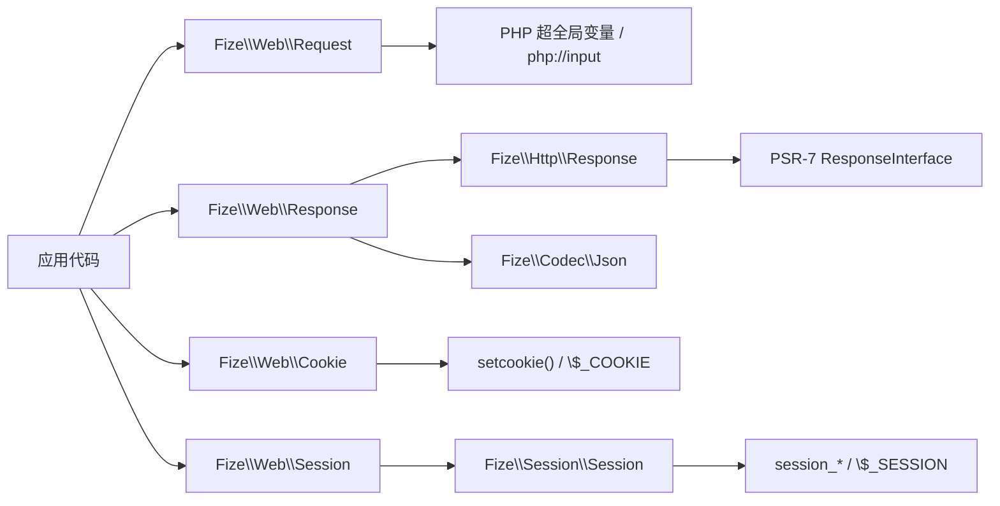

# FizeWeb 参考手册

FizeWeb（Composer 包名 `fize/web`）是一组面向 PHP Web 运行环境的参数读写类库，用来统一处理 **请求、响应、Cookie、Session**。接口以静态方法为主，尽量贴近 PHP 超全局变量的使用习惯。

本手册以当前仓库源码为准，入口为本页，类参考按源码类名分章。

| 章节 | 对应类 | 说明 |
|------|--------|------|
| [Request](Request.md) | `Fize\Web\Request` | 读取请求方法、参数、头、URL、客户端信息 |
| [Response](Response.md) | `Fize\Web\Response` | 构造并发送 HTML / JSON / XML / 跳转 / 下载响应 |
| [Cookie](Cookie.md) | `Fize\Web\Cookie` | 设置、读取、删除、清空 Cookie |
| [Session](Session.md) | `Fize\Web\Session` | 在底层 Session 启动后读写 `$_SESSION` |

- 项目仓库：[https://github.com/fizechan/FizeWeb](https://github.com/fizechan/FizeWeb)
- 在线手册：[https://fizeweb.readthedocs.io/zh_CN/latest/](https://fizeweb.readthedocs.io/zh_CN/latest/)
- 许可证：MIT（见仓库根目录 `LICENSE`）

---

## 1. 定位与边界

FizeWeb **不是**完整的 MVC 框架，也不提供路由、模板、中间件管道。它只做 Web 超全局环境的封装：

- **读**：`$_GET`、`$_POST`、`$_REQUEST`、`$_FILES`、`$_SERVER`、`$_COOKIE`、`$_SESSION`、`$_ENV`、`php://input`、请求头。
- **写**：通过 `setcookie()` 写 Cookie，通过 `$_SESSION` 写会话，通过 PSR-7 风格的响应对象输出 HTTP 头与正文。

需要路由、控制器、视图时，应把本库当作工具层嵌入自有框架或其它框架。

---

## 2. 架构

四个公开类位于命名空间 `Fize\Web`，由 `composer.json` 的 PSR-4 映射到 `src/`。



职责划分：

| 类 | 角色 | 是否必须先 `new` | 状态存放 |
|----|------|------------------|----------|
| `Request` | 只读请求上下文 | 否（有默认配置）；传入自定义配置时需要 | 静态属性：`$method`、`$header`、`$input`、`$config` |
| `Response` | 可变/不可变混合的 HTTP 响应 | 工厂方法会自行创建实例 | 实例（继承 PSR-7，`with*` 返回新对象） |
| `Cookie` | Cookie 读写 | **是**，静态方法依赖构造时写入的配置 | 静态 `$config` + `$_COOKIE` |
| `Session` | Session 读写门面 | **是**，构造时启动底层 Session | `$_SESSION`，清空走底层 `unset()` |

`Request` 与 `Cookie` 都会接触 `$_COOKIE`，但语义不同：`Request::cookie()` 原样读超全局变量；`Cookie::get()` / `has()` 会拼上配置里的 `prefix`。

---

## 3. 环境要求

| 项目 | 要求 |
|------|------|
| PHP | `composer.json` 写的是 `>=7.0.0`。实际因 `fize/http`、`fize/session` 要求 **`>=7.1.0`** |
| 扩展 | 无强制扩展。建议安装 `ext-apache`（使用 `apache_request_headers()` 读取请求头） |
| 运行模式 | 主要为 `php-fpm` / Apache / CGI；`Request::isCli()` / `isCgi()` 可识别 SAPI |
| 自动加载 | Composer PSR-4：`Fize\Web\` → `src/` |

生产依赖（版本以安装时的 `composer.lock` 为准）：

| 包 | 用途 |
|----|------|
| `fize/codec` | `Response::json()` 通过 `Fize\Codec\Json::encode()` 编码 |
| `fize/http` | `Response` 继承 `Fize\Http\Response`，并使用 `StreamFactory` 构造响应体 |
| `fize/session` | `Session` 构造时 `new Fize\Session\Session($config)`，负责 `session_start()` 与处理器 |

开发依赖：`phpunit/phpunit`、`guzzlehttp/guzzle`（Cookie 集成测试用 HTTP 客户端访问内置服务器）。

---

## 4. 安装

在项目根目录执行：

```bash
composer require fize/web
```

本仓库作为源码开发时：

```bash
git clone https://github.com/fizechan/FizeWeb.git
cd FizeWeb
composer install
```

引入后即可使用：

```php
use Fize\Web\Request;
use Fize\Web\Response;
use Fize\Web\Cookie;
use Fize\Web\Session;
```

---

## 5. 快速开始

```php
<?php
require __DIR__ . '/vendor/autoload.php';

use Fize\Web\Cookie;
use Fize\Web\Request;
use Fize\Web\Response;
use Fize\Web\Session;

new Cookie([
    'expire'   => 86400,
    'prefix'   => 'app_',
    'httponly' => true,
]);
new Session();

if (Request::isPost()) {
    $name = Request::post('name', '');
    Session::set('name', $name);
    Cookie::set('last_name', $name);
}

Response::json([
    'method' => Request::method(),
    'ip'     => Request::ip(),
    'name'   => Session::get('name'),
    'cookie' => Cookie::get('last_name'),
])->send();
```

初始化顺序建议：先 `new Cookie` / `new Session`（以及需要改配置时的 `new Request`），再调用对应静态方法。`Request` 在不改配置时可以直接调用静态方法。

---

## 6. 源码与文档对应关系

```
FizeWeb/
├── src/
│   ├── Cookie.php      → docs/Cookie.md
│   ├── Request.php     → docs/Request.md
│   ├── Response.php    → docs/Response.md
│   └── Session.php     → docs/Session.md
├── demo/               Cookie 各方法的可访问示例（部分仍带已移除的加密配置）
├── tests/              PHPUnit 用例骨架；Cookie 测例依赖 Windows 内置服务器
├── docs/               本手册
├── composer.json
└── README.md
```

`demo/`、`tests/` 在 `.gitattributes` 中标记为 `export-ignore`，Packagist 发布包默认不包含它们。

---

## 7. 使用约定

1. **先初始化再静态调用**：`Cookie`、`Session` 的静态方法依赖构造函数写入的配置或已启动的会话。未 `new Cookie` 时 `array_merge(self::$config, …)` 会因 `$config` 为 `null` 出错。
2. **`Request` 部分结果会缓存**：`method()`、`header()`、`input()` 第一次调用后写入静态属性，同一进程后续不再重新探测。
3. **`Response` 的 `with*` 是不可变的**：`noCache()`、`contentType()`、以及继承的 `withHeader()` / `withStatus()` 返回**新实例**。链式调用时必须使用返回值；`send()` 发送的是当前对象上的头与正文。
4. **手册以 `src/` 为准**：`demo/` 与 `tests/TestCookie.php` 仍出现 `encrypt_key`、`encrypt_value`、`secret_key`、`onTamper` 等旧选项，**当前 `Cookie` 类已无加解密实现**。
5. **不要把 `Request::cookie()` 和 `Cookie::get()` 混用前缀**：前者不会自动加 `prefix`。

---

## 8. 测试说明

仓库没有 `phpunit.xml`。`tests/` 中 `TestRequest`、`TestResponse`、`TestSession` 多为空方法占位。`TestCookie` 通过 Guzzle 请求 `localhost:8123`，并在构造时用 Windows 的 `start cmd` 拉起 PHP 内置服务器，注释写明仅支持 Windows。

本地若要手工验证 Cookie，可把 Web 根指到 `demo/`：

```bash
php -S localhost:8123 -t demo
```

---

## 9. 版本简记

Git 标签包括 `v1.0.0`～`v1.3.2`、`2.0.0`、`2.0.1`、`3.0.0`～`3.2.0`。与手册相关的演进：

| 时间 | 说明 |
|------|------|
| 2019-11 | 首次可用实现；修正重定向仍返回 200 的问题 |
| 2019-11 | Session 业务读写与 `Fize\Session` 底层分离 |
| 2019-12 | `Request::url()`；增强 `Cookie::set()` |
| 2020-02 | `remove` 统一改名为 `delete`；优化 `Response` |
| 2021-11 | 命名空间改为大驼峰 `Fize\Web` |
| 2022-07 | 新增 `Request::domain()` |
| 2025-07 起 | 依赖升级与代码整理；Cookie 仅保留前缀与常规 `setcookie` 参数 |

---

## 10. 许可

MIT License。版权归属 FizeChan（2019）。完整文本见仓库 [`LICENSE`](../LICENSE)。
